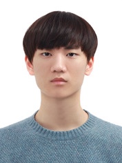
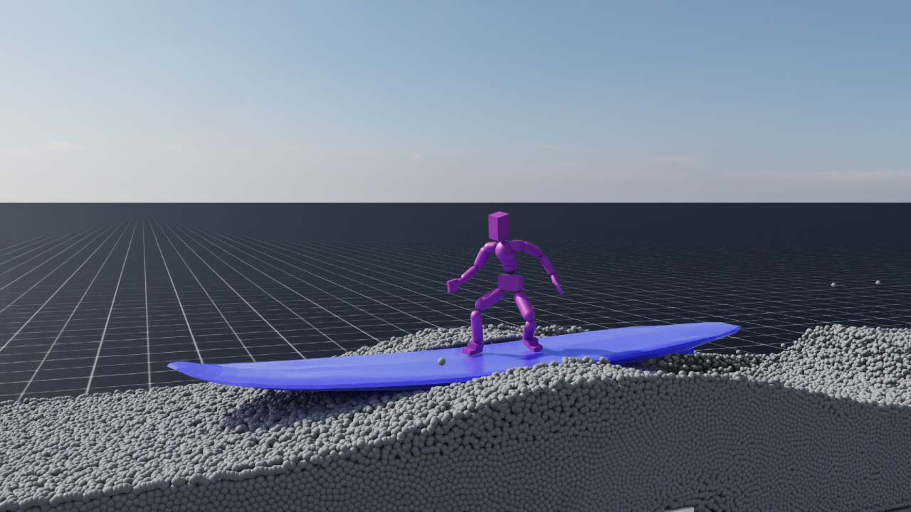
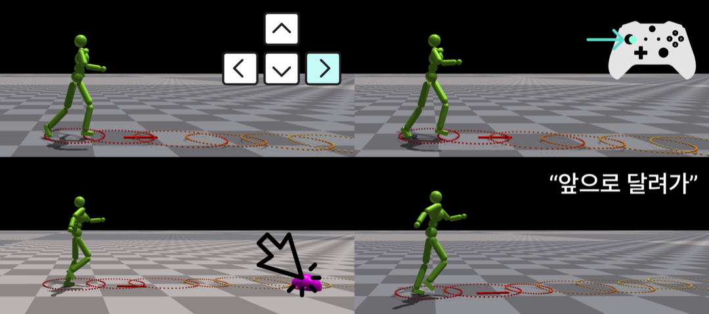

<!-- One -->
<section id="one">
    

       

<h2>Changho Lee</h2>

B.S in Computer Science, Hanyang University, Seoul, Korea, Feb.2026 
Room No. 509, IT.BT Building 
e-mail: changholee@hanyang.ac.kr

<a target="_blank" rel="noopener noreferrer" href="http://cs.hanyang.ac.kr/">Department Of Computer Science</a>
 
<a target="_blank" rel="noopener noreferrer" href="https://www.hanyang.ac.kr/">Hanyang University</a>

	  

</section>

## Research Interests
Physics Based Character Control 
 
 
 

## Publications

    
        
    
    

        <a target="_black" rel="noopener noreferrer" href="https://cgrhyu.github.io/publications/2026-learning-surfing-like.html">
        Learning Surfing-like Balance without Water Simulation</a>
    

     
    Hauk Nam, Changho Lee, Yoonsang Lee 
    SIGGRAPH 2026 Posters, July 2026

 

    
        
    
    

        <a target="_black" rel="noopener noreferrer" href="https://gitcgr.hanyang.ac.kr/publications/domestic/2026-kcgs-latent-matching.pdf">
       다양한 고수준 사용자 입력을 위한 잠재변수 매칭 기반 물리 캐릭터 제어 프레임워크</a>
    

     
    이창호, 이윤상 
    한국컴퓨터그래픽스학회 2026년 학술대회 논문집, 103-104, 2026.07.

    
 
 
 
